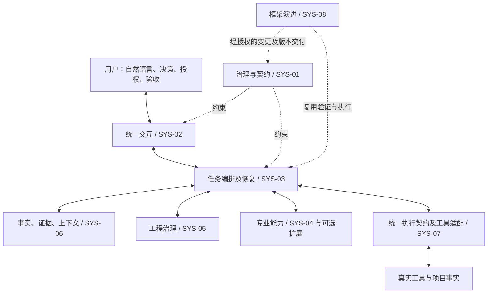

# SRF 概要设计

- 状态：PH-05 候选概要设计，未批准为详细设计或运行规范，未实施。
- 依据：提交 `447787c9fa7df2e3a32b4b36abdb7a496d164a6c` 中 [顶层设计](SRF_TOP_LEVEL_DESIGN.md)、[目录规划](SRF_REPOSITORY_LAYOUT.md)、[正式需求规格](../project/SRF_REQUIREMENTS_SPECIFICATION.md)（52项，36 P0、16 P1，D01–D06）、[研究综合记录](../research/SRF_RESEARCH_SYNTHESIS.md) 第11节（本轮负责人已批准A01–A08及知识体系方向）、[路线图](../project/SRF_DEVELOPMENT_ROADMAP.md)。当前研发状态见 [PROJECT_STATE](../../management/PROJECT_STATE.md)。
- 2026-11-27 负责人明确批准PH-04结项及PH-05启动，授权候选设计写入main；重要架构及设计决策仍需确认。本文作为独立的概要架构成果，不复制顶层哲学、需求正文或研究历史；不改变其已批准约束，不是软件运行入口。
- 目标：确定可实施的逻辑职责、运行模型、核心/扩展边界、必要加载依赖、关键接口及风险验证路径，为PH-06详细设计和PH-07文件/协议设计提供依据。物理文件、最终模块ID、字段、脚本、CI、确切平台接口与测试阈值不在此冻结。

## 1. 架构选择及运行边界

候选采用规范驱动、AI解释执行、工具适配的逻辑架构。SRF Specification 是版本化规范、知识、规则、契约与协议；Runtime 是能够理解并执行规范的AI环境（V1.0 GPT Project）；Adapters 对接真实工具能力；软件项目拥有自己的业务事实、配置及状态。不是把ChatGPT当作确定性工作流引擎，不假设运行环境能自动执行任意脚本或持续后台运行。框架核心与平台限制分离，但平台法律、安全、权限等实际约束始终生效。确定性校验工具可按实际能力提供额外保护，不要求首版独立引擎、多Agent平台或完整插件市场。

图中连线为运行交互/约束，不是物理文件加载依赖；同一AI可承担多职责，并不表示多进程或独立审核。最小内核只保证必要的安全与运行闭环；PH-09补足通用专业能力及软件启动入口。业务项目只加载指定Release与合法配置，不使用研发中心指令；SRF 自身在首发前仍仅 main，绝不因通用适配设计放宽本Project白名单。

## 2. 八大体系：职责及唯一责任边界

沿用正式需求的分组作为主责任归属，跨体系协作不改变需求归属，非物理目录映射。

| 体系 | 名称 | 主责 | 主要输出 | 非职责 | 需求主责区间 |
|---|---|---|---|---|---|
| SYS-01 | 框架基础 | 规则与生效配置；模块契约、加载准入、扩展边界 | 有效规则/配置解释；稳定契约 | 不作任务授权，不维护业务事实，不执行工具 | 001–006 |
| SYS-02 | AI 协作 | 意图与模式、专业主动审视、决定及任务授权的有效性、自然语言反馈 | 任务意图、有效授权判断、决策请求、反馈 | 不自行扩大权限，不替代工程质量判定 | 007–011 |
| SYS-03 | 研发编排 | 任务目标与完成条件、风险/复杂度/自主范围、活动组合、执行协调、异常恢复 | 必要活动与顺序、执行/暂停/交接决策 | 不另设规则优先级，不直接代替专业工作或工具，不复制当前状态 | 012–016 |
| SYS-04 | 专业研发 | 产品、需求、架构设计、编码、测试、交付维护；提出专业工作及适用验收方法 | 候选需求/方案、实现或测试意图、专业审查结果 | 不自行授予操作权限，不直接绕过统一执行协议，不把建议当已实施 | 017–022 |
| SYS-05 | 工程治理 | 影响分析、风险、安全研发、质量门槛、适当审查及变更管理 | 验证需求、风险与质量判定、阻塞原因 | 不自行批准重要决策、不伪造证据，不另设权限规则 | 023–027 |
| SYS-06 | 知识与状态 | 事实来源、证据语义、上下文加载、状态记录、知识生命周期和追踪 | 版本定位、事实/未知、证据分类、恢复现场 | 不重定义各专业规则，不把状态当执行结果，不推定历史授权仍有效 | 028–032 |
| SYS-07 | 工具适配 | 能力识别、统一仓库操作协议的工具映射、调用前范围检查、执行结果及降级 | 实际工具能力/结果、差异、错误或未知 | 不授予业务权限，不决定需求/验收，不跨仓库绕过 | 033–036 |
| SYS-08 | 框架演进 | 反馈诊断、框架受控变更、框架评价及独立发布迁移 | 演进候选、版本/兼容建议、回归与交付要求 | 不自行修改核心，不另造质量/授权机制，不在业务项目研发SRF | 037–052 |

### 2.1 跨体系的唯一责任

| 关注点 | 权威定义/责任 | 使用方及交接 |
|---|---|---|
| 规则和允许覆盖的配置 | SYS-01解释有效规则及契约；用户确认的项目绑定配置为目标唯一来源 | SYS-02/03/05/07消费有效约束，SYS-06定位来源，不复制规则 |
| 意图、决定、授权 | SYS-02解释实际用户输入并判定授权范围/效力；负责人作重要决定 | SYS-03据此决定推进；SYS-07核对真实调用参数，不以技术权限新增授权；SYS-06保存必要依据 |
| 任务与恢复 | SYS-03负责活动选择、任务状态推进及异常恢复协调 | SYS-06负责状态记录语义和权威入口；SYS-07核实真实执行结果，不另建状态账本 |
| 风险与质量 | SYS-05定义适用门槛及质量判定；SYS-03据风险裁剪活动 | SYS-04提出专业风险及用例，SYS-07执行可用检查，SYS-06记录证据，SYS-08复用框架验证 |
| 事实和证据 | SYS-06规定证据语义、来源、版本、冲突及未知；原始事实仍以实际源文件/工具/批准记录为准 | SYS-07提供真实结果；SYS-05作质量结论，不能以状态或自评冒充证据 |
| 工具执行 | SYS-07负责统一操作契约及适配映射、调用前检查、结果回读 | SYS-03协调执行，SYS-04表达专业操作意图；能力不足时交接，不绕过 |
| 框架反馈与发布 | SYS-08负责诊断、演进和独立交付的专业流程 | 复用SYS-01/02/03/05/06/07，负责人批准核心变更与发布；业务项目不能自动回写框架 |

SYS-01 不直接产生授权；SYS-02 不直接产生证据；SYS-05 的质量判定不赋予操作权限；SYS-06 的历史记录不赋予当前授权；SYS-07 的工具能力不代替批准。必要时复核这些判定，但不在每个体系重新定义同一规则。

## 3. 候选逻辑模块及必要加载依赖

下列 M01–M09 是概要阶段工作包定位标识，不是正式模块ID或文件数量承诺。模块可以包含多个紧密职责，详细设计可合并/拆分但须保留责任归属和必要关联。M09是扩展类别而非首版必装模块。

| 逻辑单元 | 职责 | 体系 | 必要规范前置（候选） | 建设阶段 | 最小输出 |
|---|---|---|---|---|---|
| M01 | 治理与契约 | SYS-01 | 无（根契约） | PH-08 | 有效规则、配置、契约 |
| M02 | 意图与权限 | SYS-02 | M01 | PH-08 | 意图、授权判定、决策边界 |
| M03 | 事实证据与上下文 | SYS-06 | M01 | PH-08 | 事实/状态/证据/加载语义 |
| M04 | 工程治理与质量 | SYS-05 | M01、M02、M03 | PH-08 | 风险/质量门槛，专业化检查后续补足 |
| M05 | 统一执行契约与基础适配 | SYS-07 | M01、M02、M03 | PH-08 | 范围校验、能力与工具结果 |
| M06 | 任务编排与恢复 | SYS-03 | M01、M02、M03、M04、M05 | PH-08 | 活动选择、执行协调、停止恢复 |
| M07 | 专业研发能力 | SYS-04 | M01 | PH-09 | 按需专业方法与工作请求 |
| M08 | 框架演进能力 | SYS-08 | M01 | PH-08/09 | 基本保护在内核自用；完整反馈/评估/迁移后续建设 |
| M09 | 领域扩展 | SYS-01/SYS-04 | M01 | PH-09 按需 | 可选领域专业内容与契约声明 |

本表只描述必要**规范加载前置**：A依赖B表示解释A前需有B的有效契约，不代表读取B所有正文。候选前置图共9个逻辑单元、16条有向边，内存拓扑排序通过（示例顺序 M01 → M02 → M03 → M07 → M08 → M09 → M04 → M05 → M06）；仅静态模型，无实际文件或运行验证。M07/M08/M09按任务触发，不能从无前置的表述推定可绕过治理、授权、质量或工具约束。专业和扩展契约的实际加载闭包PH-06/07确定。

四类关系应分开：治理适用（核心约束贯穿）、必要加载（可检查闭包/循环）、语义追踪（可双向，非运行前置）、调用/结果反馈（可双向、有停止条件）。入口先核实根身份和必要治理，再取得当前项目事实与授权，之后按需加载；读仓库本身须满足已知绑定和读权限，启动入口应保留最低准入规则，不能依赖尚未读取的远端规则来证明读取合法。M03 可通过M05获得事实，但M03的**证据语义契约**在M05规范之前可定义；实际读写请求不得因运行交互形成无限递归。PH-06须审查启动自举、能力发现、前置冲突与预算不足。

## 4. 核心、专业、扩展及知识边界

- 核心：根治理及必要契约、意图和权限、基础编排、必要事实/证据/恢复、质量与执行保障。PH-08建立闭环，而非穷尽全部专业治理。基本自身迭代保护贯穿内核（稳定入口、规则唯一、可验证差异及恢复），不是新增一个永久高权限角色。
- 通用专业能力：产品/需求、架构/设计、开发、测试、发布维护及适用知识与模板；每项首版最小充分路径，PH-09完成。规则及知识按职责维护，SYS-06定位与加载。详细专业方法可借助已核实外部知识，不在核心固化具体语言/领域。
- 工具适配：统一执行契约与平台具体映射分离；首版验证GPT Project/GitHub，其他工具只在真实能力及授权内适配或交接。通用规范不因GitHub接口变化而修改。
- 领域扩展：项目差异优先配置，领域共性才扩展；首版无需全领域扩展或市场。扩展声明依赖、兼容、职责、权限；不可覆盖核心。加载失败时停用相关能力或阻塞依赖任务，不绕过。
- 运行知识采用A06已批准三视角：八体系职责、MUST/SHOULD/MAY/REFERENCE/TEMPLATE性质、四类上下文。知识和规则在职责权威处维护，索引不复制全文。研究、设计、测试与运行包隔离。具体目录及清单按PH-07设计，不预建文件。

## 5. 运行模型与最小交接语义

### 5.1 启动与恢复

用户自然语言进入 → 核实Project绑定、根约束、实际版本和可读权限 → 读取稳定入口、有效规则、唯一状态及当前任务所需事实 → 判断意图、有效授权、工具能力及冲突 → 继续已授权任务或安全只读/交接。缺失/冲突绑定、核心规则不可读、过期授权等情况不得进行受影响操作。首次新软件项目从明确授权的指定版本安装启动；既有项目先只读盘点，不能擅自重构。历史摘要仅导航，事实仍需核实；新任务或授权撤回/失效重新判断。启动/恢复路径在PH-06/07细化，PH-08及PH-11实测。

### 5.2 任务运行闭环

任务意图及目标 → 有效规则/事实/授权判断 → 风险与复杂度裁剪、专业能力选择 → 候选方案/必要批准 → 受控执行 → 核对实际结果与适用验收 → 状态更新、反馈或恢复。非固定步骤；只读探讨不触发写入，用户停止后不再继续受影响动作。低风险常规细节在有效授权内自主推进；重要取舍按已有L3/L4确认。执行前重新校验实际仓库、分支、路径、基线、权限及工具能力；计划与写入之间事实变化则重新判断。失败/未知/部分成功优先核实远端、保护无关范围，必要时经授权补偿或交接。不默认强推，不把Git引用更新等同外部业务事务原子性。

### 5.3 逻辑交接契约（语义候选，不是字段协议）

| 交接 | 最小必要语义 | 负责/消费 |
|---|---|---|
| 意图与任务 | 对象、目标、模式、已知事实、未知、预期成果/完成条件 | SYS-02 → SYS-03 |
| 决策及权限 | 有效来源、对象、范围、条件、必要批准、撤回/失效、禁止事项 | SYS-02 → SYS-03/07 |
| 事实及加载 | 权威引用、实际版本、冲突/未知、必要依赖、加载失败 | SYS-06 ↔ SYS-03/07 |
| 专业工作 | 所需能力、约束、上下文、建议/执行意图、预期结果及验证 | SYS-03 ↔ SYS-04 |
| 治理判定 | 风险、受影响对象、适用质量门槛、需审批或阻塞原因 | SYS-05 → SYS-03 |
| 工具请求与结果 | 明确目标/版本、授权引用、操作及预期差异、实际能力/执行/错误/未知、核验证据 | SYS-03 ↔ SYS-07 |
| 验证与状态 | 验收条件、实际证据及限制、结论、已完成/未完成、恢复点 | SYS-05/07 → SYS-06；SYS-03协调更新 |
| 演进及发布 | 反馈来源、影响版本、根因及变更建议、兼容/迁移、回归、发布授权与实际产物 | SYS-08复用以上契约 |

这些是最小必要信息，不要求每项任务创建独立对象或记录文件；具体字段、序列化、状态转换、必要兼容标识和工具API由PH-06/07确定。统一权威状态只指向已有事实与证据，不维护重复任务表。无持久化工具时明确交接内容与未写入状态。

## 6. 关键场景与架构风险（纸面走查）

| 场景 | 主要职责协作及预期结果 | 验证阶段 |
|---|---|---|
| 已授权简单局部修改 | 02/03最小裁剪，04提出变更，05适用检查，07实际差异，06必要状态；无多余确认 | PH-08/10 |
| 模糊构想或审查 | 02识别只读及未知，04提出方案，03仅在获授权时继续；无未授权副作用 | PH-08/10 |
| 高风险低复杂度操作/不可信文本 | 01约束、02授权、05风险、07调用前拒绝；实际平台保障按能力落实 | PH-08/10 |
| 读取受限、上下文缺失及旧授权 | 06报告未知，02/03重新判断，07安全降级；不假装恢复 | PH-08/10 |
| 并发、超时或部分写入 | 07核实实际结果，03协调恢复，05确定必要验证，06保持真实状态 | PH-08/10 |
| 工具或专业能力替换 | 01契约兼容、07能力识别/降级、04独立专业输出，08必要回归 | PH-10 |
| 已有工程接管、安装升级及退出 | 08协调生命周期，01/02/05/07保护配置及业务、06追溯；实际构建/必要运行 | PH-11 |
| 框架反馈与规则演进 | 08诊断根因，03协调，02重要授权，05/07/06真实回归及版本证据；不得自行改变核心 | PH-10/13 |

| 关键风险 | 候选处理及剩余不确定性 |
|---|---|
| 文本规则被模型忽略、注入或平台全局授权越界 | 最小权限、明确目标、调用前检查与外部实际保护；行为规则非系统隔离，关键安全场景需实测 |
| 启动依赖自举/循环、加载过多或漏读 | 根入口最小安全准入、契约前置DAG、按需加载与缺失阻塞；实际加载开销未知 |
| 过度拆分或多职责重复规则 | 唯一责任、稳定契约与按需拆合；比较变更影响与用户负担 |
| 事实、状态与执行结果不一致 | 独立证据语义、实际回读、未知结果恢复及受保护差异；并发/部分失败尚未专项验证 |
| 专业能力只是流程模板 | 每项专业最小真实工作路径；REQ-018数据/算法/交互及021可观测性补研 |
| 过早固定平台/协议或遗漏必要能力 | 逻辑语义先行，PH-06/07细化，PH-08/09试测；未实现能力明确降级 |
| 安装迁移导致项目数据丢失 | 版本化运行包、配置隔离、兼容及恢复检查；真实安装/退出PH-11 |
| 评价偏差、成本过高及安全假象 | A08配对试测、分层覆盖、实际证据与独立复核；正式阈值前置审批，D01/D02保持 |

## 7. 候选架构取舍（待负责人确认）

| ID | 重要取舍 | 推荐方案与替代 |
|---|---|---|
| H01 | 运行架构 | 规范驱动、AI解释执行、工具适配；首版不开发独立确定性引擎或多Agent平台。替代：先建执行引擎，强制性可能更好但范围、成本及工具依赖增加；维持顶层与A01/A03。 |
| H02 | 职责与唯一责任 | 保留八体系，采用第2节的主责和跨体系权威边界；系统间共享契约而非重复规则。替代：每体系独立流程会增加冲突和状态同步。 |
| H03 | 内核与扩展边界 | 采用第3/4节最小闭环、专业按需及工具适配；M01–M09仅概要工作定位。替代：全能力进入核心增加加载成本，过早插件平台增加设计负担。 |
| H04 | 依赖与交接模型 | 区分治理、加载、追踪、调用；必要加载前置可静态检查，允许运行反馈；统一第5节交接语义，详细协议后续设计。替代：单一依赖图易误判循环，全面预定义字段易过度工程。 |
| H05 | 安全、事实和恢复 | 意图/授权、工具能力、实际证据分离；重要动作调用前校验，真实核验，缺失/未知停止受影响动作并恢复；不宣称系统隔离。替代：仅依赖模型自检或提交后审核不能充分保障安全。 |
| H06 | 实现与验证递进 | PH-06/07先定义契约/文件协议，PH-08内核闭环及自用，PH-09专业/入口，PH-10/11实际验证；高不确定性原型可在受控素材中实验但不跳过批准。替代：直接生成发布包使职责冲突及验证成本后移。 |

批准对象为概要方向与边界，非正式模块ID、具体文件格式、状态机、权限变更或发布。H01–H06细化已批准基线，不默认修改52项需求及A01–A08；若后续发现重要冲突另行取得确认。

## 8. 阶段审查及后续详细设计

当前已完成八体系责任分配、52项主责覆盖、核心与扩展边界、逻辑依赖静态模型、运行闭环、主要交接、风险/验证场景及待审批取舍。采用的需求区间与正式规格一致，候选依赖模型经内存拓扑检查（不是实际模块测试）。尚未完成独立人工架构评审、详细模块/协议、正式行为测试或环境验证；安全保障、专业深度、实际工具、许可、量化评估及安装发布限制延续研究记录。未修改核心规则、正式需求或目录规划。

下一步先由负责人审查H01–H06，必要时调整方案；批准概要设计后再进入PH-06八体系详细设计。建议详细设计按依赖而非编号顺序组织：基础契约及意图权限 → 事实/证据/上下文 → 工程治理与执行契约 → 编排恢复 → 专业研发与演进，最后综合职责/失败路径与全需求映射；具体任务拆分待批准。PH-07定义文件、索引、状态及兼容协议，PH-08才建设最小内核。不以本概要文档的写入作为框架完成或阶段自动结项。
